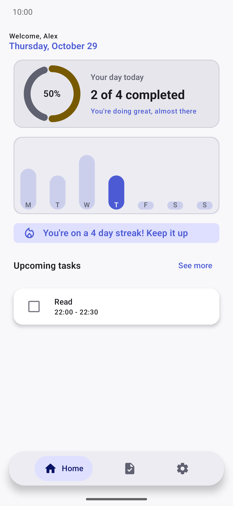
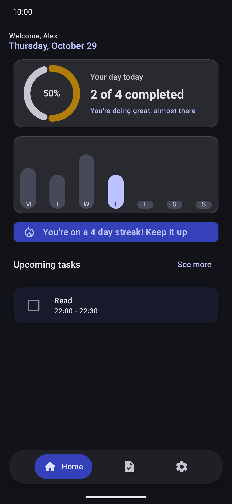
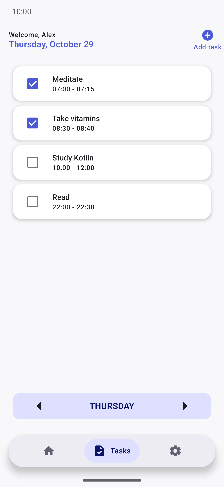
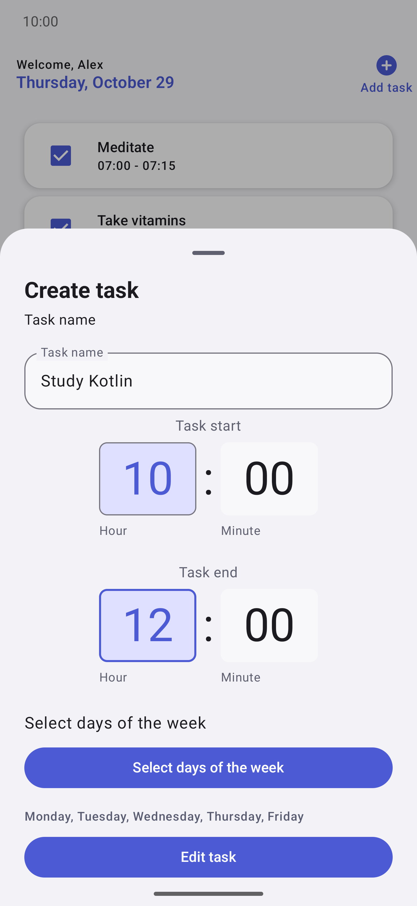
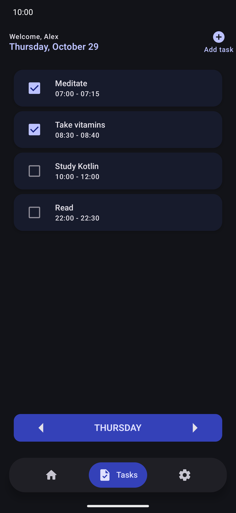
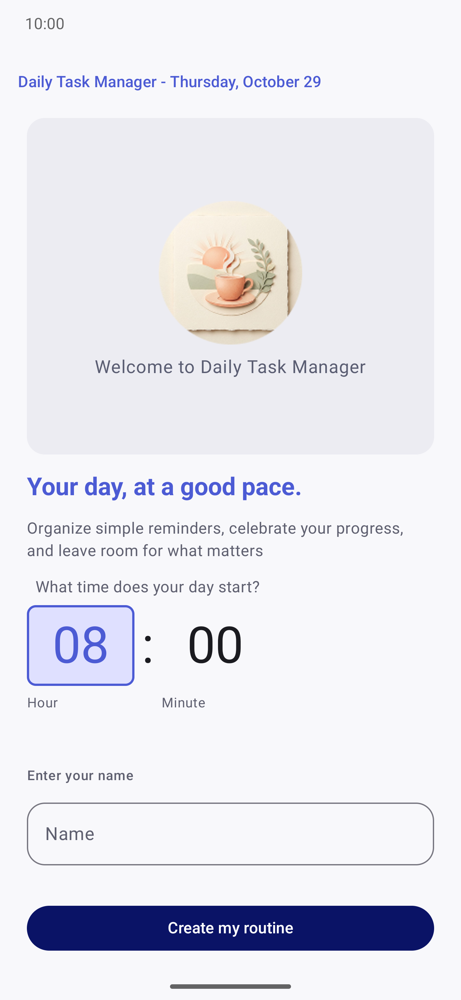
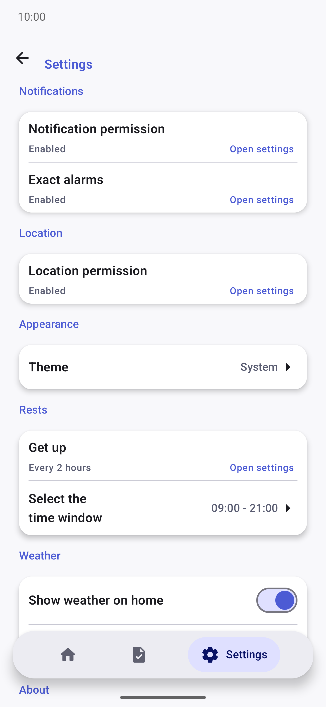

# Daily Task Manager

**Tu día, con buen ritmo.** App nativa de Android para construir una rutina diaria. Tiene tareas recurrentes con recordatorios que te acompañan hasta que acaba cada una, un panel que celebra tu progreso y avisos para levantarte y moverte.

[English](README.md)

<p align="center">
  
  
</p>

---

## Funcionalidades

### Rutina y tareas
- **Tareas recurrentes**: cada tarea tiene nombre, hora de inicio y de fin, y los días de la semana en que se repite.
- **Vista por día**: consulta las tareas de cualquier día de la semana, ordenadas por hora de inicio.
- **Márcalas al terminar**: marca como hechas las tareas de hoy. Cada día se guarda por separado, así que conservas el historial.
- **Desliza para borrar, con deshacer**: la tarea desaparece al momento y solo se borra cuando se cierra el aviso de "Deshacer".
- **Edición directa**: toca una tarea para modificarla. Se conservan su historial y su fecha de creación.
- **Validación**: una tarea necesita un nombre y al menos un día, y tiene que terminar después de empezar.

<p align="center">
  
  
  
</p>

### Recordatorios inteligentes
- **Notificación a la hora de inicio**: alarmas exactas cuando el sistema lo permite y, si no, alarmas inexactas automáticamente.
- **Notificación persistente**: sigue visible hasta la hora de fin de la tarea y desaparece sola cuando acaba.
- **Acciones desde la notificación**: *Completar* la tarea o *Posponer 10 min*. El recordatorio pospuesto vuelve a sonar.
- **Aguanta el día a día**: los recordatorios se reprograman al reiniciar el móvil, al actualizar la app, al cambiar la hora o la zona horaria y al cambiar el permiso de alarmas exactas.

<!-- TODO: captura de la notificación de tarea con sus acciones -->

### Panel de inicio
- **Progreso de hoy**: un anillo animado con el porcentaje de tareas de hoy completadas.
- **Gráfico semanal**: el porcentaje completado de cada día de la semana actual, con el día de hoy resaltado.
- **Racha**: los días seguidos en los que completaste al menos una tarea programada.
- **Próximas tareas**: las tres siguientes que aún te quedan hoy.
- **Tarjeta del tiempo** (opcional): temperatura actual, máxima y mínima del día y probabilidad de lluvia, en °C o °F. Usa [Open-Meteo](https://open-meteo.com/) y no necesita clave de API.

<!-- TODO: captura del panel de Inicio con la tarjeta del tiempo -->

### Recordatorios para levantarte
- Avisos para levantarte y estirarte cada 1, 2, 3 o 4 horas.
- Solo saltan dentro de la franja horaria que elijas, por ejemplo de 09:00 a 21:00.

### Personalización
- **Onboarding** para indicar tu nombre y a qué hora empieza tu día.
- **Tema** del sistema, claro u oscuro, con Material 3 y barras del sistema edge-to-edge.
- **Ajustes**: estado de los permisos de notificaciones, alarmas exactas y ubicación con acceso directo a cada uno, unidad de temperatura, mostrar u ocultar el tiempo y enviar comentarios.
- **Traducida** al inglés y al español.

<p align="center">
  
  
</p>

---

## Stack tecnológico

| Área | Tecnología |
| --- | --- |
| Lenguaje | Kotlin 2.2.10 (target Java 17) |
| UI | Jetpack Compose (BOM 2026.02.01), Material 3, Material Icons Extended |
| Navegación | Navigation Compose 2.10.1 con rutas type-safe `@Serializable` |
| Inyección de dependencias | Koin 4.2.2 (`koin-android`, `koin-compose`, `koin-compose-viewmodel`) |
| Base de datos local | Room 2.8.5 (KSP 2.3.4, plugin Gradle de Room con esquemas exportados) |
| Preferencias | Jetpack DataStore Preferences 1.2.1 |
| Red | Ktor Client 3.6.0 (motor OkHttp, content negotiation, timeouts) |
| Serialización | kotlinx.serialization JSON 1.11.0 |
| Asincronía | Kotlin Coroutines y Flow (`StateFlow`, `stateIn`, `shareIn`, `flatMapLatest`) |
| Ubicación | Google Play Services Location 21.4.0 + `kotlinx-coroutines-play-services` |
| Programación de avisos | `AlarmManager` (alarmas exactas o inexactas) y `BroadcastReceiver`s |
| Arranque | AndroidX SplashScreen 1.2.0 |
| Logs | Timber 5.0.1 (solo en builds de debug) |
| Testing | JUnit 4, AndroidX Test, Espresso, Compose UI Test, Room Testing |
| Build | Gradle 9.6, Android Gradle Plugin 9.4.1, version catalog (`gradle/libs.versions.toml`) |

**Niveles de SDK:** `minSdk 26` (Android 8.0) · `targetSdk / compileSdk 37`

---

## Arquitectura

La app es un único módulo (`:app`) con **MVVM y flujo de datos unidireccional**:

```
UI Compose  ──eventos──▶  ViewModel  ──▶  Caso de uso / Repositorio  ──▶  Room · DataStore · Ktor · Play Services
     ▲                        │
     └───── StateFlow ────────┘
```

- **UI (Compose):** las pantallas recogen `StateFlow`s con `collectAsStateWithLifecycle()` y envían los eventos del usuario a su ViewModel. Los permisos y los intents del sistema se quedan en la capa de UI.
- **ViewModels:** exponen estado de UI inmutable construido a partir de los `Flow` de los repositorios, con `stateIn(WhileSubscribed)`. Los datos que dependen de la fecha se derivan de un flujo de "hoy", así que se actualizan pasada la medianoche.
- **Orquestación:** `TaskReminderUseCase` mantiene sincronizados la base de datos y las alarmas: insertar → programar, actualizar → reprogramar, borrar → cancelar.
- **Datos:**
  - Los repositorios (`TaskRepository`, `UserRepository`, `SettingsRepository`, `LocationRepository`, `WeatherRepository`) aíslan Room, DataStore, el Fused Location Provider y la API de Open-Meteo.
  - Los errores se capturan en esta capa; la cancelación de corrutinas se relanza.
- **Segundo plano:**
  - `TaskAlarmScheduler` y `StandUpScheduler` programan las alarmas.
  - Los receivers muestran las notificaciones, gestionan sus acciones y reprograman tras un reinicio o un cambio de hora.
- **DI:** un único módulo de Koin (`AppModule.kt`) conecta todas las piezas. Los receivers obtienen sus dependencias con `KoinComponent`.

### Estructura del proyecto

```
app/src/main/java/com/example/dailytaskmanager/
├── AppModule.kt               # Módulo de Koin
├── DailyTaskApplication.kt    # Koin, Timber, canales de notificación
├── MainActivity.kt            # Splash + tema + navegación
├── components/                # Composables reutilizables (TaskItem, WeeklyStatView, WeatherComponent…)
├── dao/                       # DAOs de Room
├── database/                  # AppDatabase, type converters, migraciones
├── debug/                     # Datos de ejemplo (solo builds de debug)
├── model/                     # Entidades y modelos (Task, TaskCompletion, User, StandUpConfig…)
├── navigation/                # Rutas type-safe, NavHost, destinos de la barra inferior
├── notifications/             # Programador de alarmas, receivers, notificaciones
│   └── standUp/               # Recordatorios para levantarse
├── repository/                # Repositorios y TaskReminderUseCase
├── ui/                        # Tema y mapeo de enums a strings
├── uistate/                   # Clases de estado de UI y errores de validación
├── utils/                     # Fechas, cálculo de próximos avisos y de la racha, intents del sistema
├── viewmodel/                 # Un ViewModel por pantalla + MainViewModel (estado de arranque)
└── views/                     # Pantallas: Onboarding, Inicio, Tareas, Ajustes, hoja de crear tarea

app/schemas/                   # Esquemas de Room exportados (usados por los tests de migración)
app/src/test/                  # Tests unitarios JVM
app/src/androidTest/           # Tests instrumentados (migraciones de base de datos)
```

---

## Cómo ejecutarlo

### Requisitos
- Una versión reciente de **Android Studio** compatible con AGP 9.4.
- **JDK 17** o superior. Vale el JDK que incluye Android Studio.
- Emulador o dispositivo con **Android 8.0 (API 26)** o superior.

No hacen falta claves de API ni configuración extra: la API del tiempo es pública.

### Ejecutar

```bash
git clone <url-del-repositorio>
cd DailyTaskManager
./gradlew :app:installDebug          # Windows: gradlew.bat :app:installDebug
```

O abre el proyecto en Android Studio y pulsa **Run**.

Las builds de debug rellenan una base de datos vacía con tareas y completados de ejemplo, para que el panel tenga datos desde el primer arranque.

### Tests

```bash
./gradlew :app:testDebugUnitTest            # Tests unitarios JVM (lógica de avisos y rachas)
./gradlew :app:connectedDebugAndroidTest    # Tests instrumentados, requiere dispositivo/emulador
```

### Permisos

| Permiso | Para qué |
| --- | --- |
| `POST_NOTIFICATIONS` | Recordatorios de tareas y de levantarse (Android 13+) |
| `SCHEDULE_EXACT_ALARM` | Avisos a la hora exacta. Si se deniega, se usan alarmas inexactas |
| `RECEIVE_BOOT_COMPLETED` | Reprogramar los avisos tras reiniciar |
| `ACCESS_COARSE_LOCATION` | Ubicación aproximada para la tarjeta del tiempo (opcional) |
| `INTERNET` | Previsión del tiempo |

---

## Estado del proyecto

🚧 **En desarrollo activo**, versión `0.5.1`.

- Las funcionalidades principales (tareas, recordatorios, panel, avisos para levantarse, ajustes y onboarding) funcionan.
- Los tests unitarios cubren la lógica de programación de avisos y de rachas. Un test instrumentado comprueba que las bases de datos existentes siguen abriendo con el código actual.
- La build de release tiene R8 activado, pero todavía no se ha probado.
- En [`AUDIT.md`](AUDIT.md) hay una auditoría técnica con los puntos pendientes.

---

## Próximos pasos

- [ ] **Preparar el release:** añadir `proguard-rules.pro`, verificar la build de release con R8 y configurar la firma y el versionado.
- [ ] **Política de privacidad:** publicarla, enlazarla desde Ajustes y redondear las coordenadas que se envían a la API del tiempo.
- [ ] **Actualizar dependencias:** las librerías AndroidX (core, lifecycle, activity, test).
- [ ] **Más tests:** de ViewModels con `kotlinx-coroutines-test` y Turbine, y de DAOs.
- [ ] **Calidad de código:** añadir ktlint/detekt y dividir las pantallas grandes en composables Route/Screen.
- [ ] **Avisos con antelación:** notificar 5/10/15 minutos antes de que empiece la tarea (ya está esbozado en Ajustes).
- [ ] **Restaurar copias de seguridad:** reprogramar los avisos al restaurar en un dispositivo nuevo.
- [ ] **Tareas que cruzan la medianoche**, por ejemplo de 23:00 a 01:00.
- [ ] **Widget** de pantalla de inicio con el progreso de hoy y la siguiente tarea.
- [ ] **CI:** build, lint y tests en cada push.
